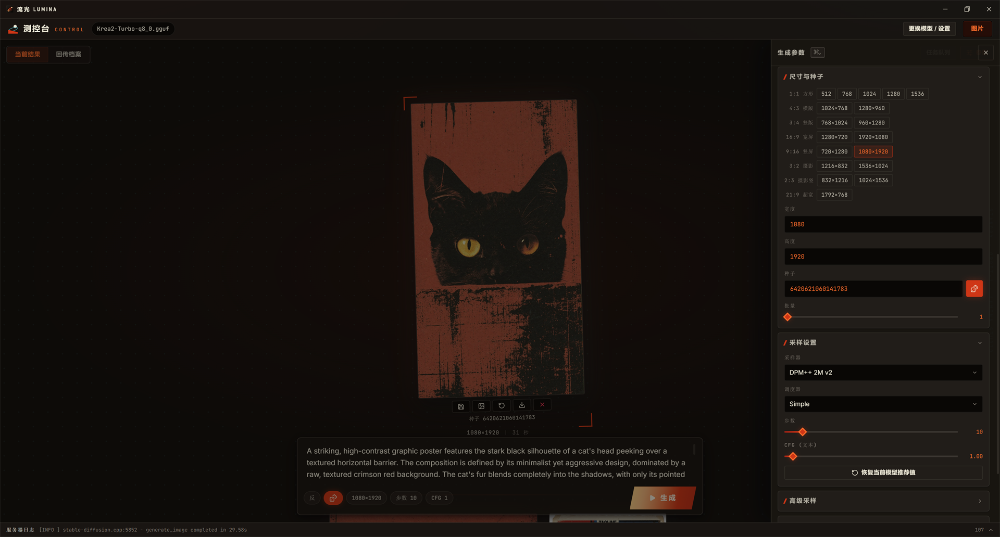
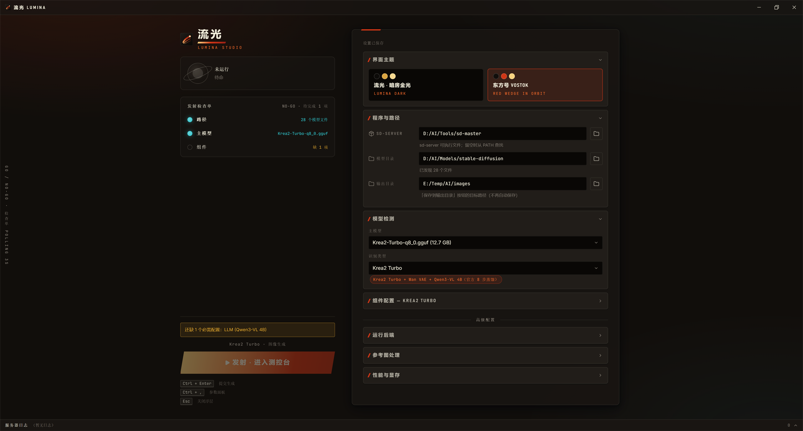

# 流光 Lumina


[stable-diffusion.cpp](https://github.com/leejet/stable-diffusion.cpp) 的第三方桌面客户端。它负责启动和看管 `sd-server`，并提供一套完整的图片 / 视频生成界面，可以替代上游自带的 webui。不隶属于上游项目，独立开发和发布。

`sd-server` 的门槛主要在启动那一步。不同模型家族要的组件完全不同：Flux.1 要 diffusion 模型加 VAE、CLIP-L、T5-XXL，Wan 换成 UMT5，MiniMax-H3 还要视频 VAE、音频 VAE 和一个 32B 的 Qwen3-VL。少给一个或者路径写错，进程直接退出，原因埋在日志里。Lumina 把这一步变成一张检查单：扫描模型目录、认出家族、列出还缺什么，顺手校验 `--max-vram`、`--backend` 这类容易写错的参数，齐了才让你按启动。

启动之后进入生成界面，当前家族的推荐参数、尺寸与帧数预设都已经填好，写完提示词就能出图。



## 安装

### 用安装包

从 [Releases](https://github.com/AmeowCAT/lumina/releases) 下载 MSI 或 NSIS 安装包装上即可。

界面本身不含推理内核，你需要自备编译好的 `sd-server`（见上游[构建说明](https://github.com/leejet/stable-diffusion.cpp/blob/master/docs/build.md)），把它所在目录填进控制台即可，已在 `PATH` 里则留空。

### 从源码构建

前置：Node.js 20.19+（仓库带 `.nvmrc`）、Rust stable、以及 Tauri 在你平台上的[系统依赖](https://tauri.app/start/prerequisites/)。

```bash
git clone https://github.com/AmeowCAT/lumina.git
cd lumina
npm install

npm run dev:desktop    # 开发模式，前端热更新，且打开 WebView Inspector（F12）
npm run tauri build    # 打包安装包（发布包不带 Inspector）
```

Windows 上 `tauri build` 产出两个安装包和一个免安装可执行文件：

```
src-tauri/target/release/bundle/msi/Lumina_<版本>_x64_en-US.msi
src-tauri/target/release/bundle/nsis/Lumina_<版本>_x64-setup.exe
src-tauri/target/release/lumina.exe
```

日常开发与验证都在 Windows 上进行。依赖本身跨平台，macOS 与 Linux 应该能构建，但没有 CI，也没有系统性验证过。

## 上手

### 控制台



1. **程序与路径**：选 `sd-server` 所在目录（在 `PATH` 里可留空）、模型根目录、输出目录。模型目录会被扫描归类，支持 ComfyUI 那种分目录结构，分片模型只显示 `.safetensors.index.json` 索引、隐藏碎片。
2. **模型检测**：选主模型，家族自动识别，识别错了可以手动覆盖。
3. **组件配置**：按家族列出需要的组件，可选项标了"（可选）"，下方给出该家族该用哪种权重的说明。
4. 检查单全绿后点**启动服务器**，加载完成会自动进入生成界面。

运行后端、参考图处理、性能与显存三块折叠面板放着 `--backend`、`--params-backend`（权重驻留后端，`disk` / `cpu` / `te=cpu,vae=cpu`）、`--threads`（0 = 由内核按 CPU 物理核数决定）、`--rpc-servers`（多机拆卡的 `host:port` 列表）、`--type` 量化、CPU 卸载、`--max-vram`、队列上限、启动端口和附加启动参数。`--params-backend` 与 `--rpc-servers` 写错形状会在启动前就被拦下（前者不接受 `&` 设备列表，后者端口必须在 1–65535），不必等内核报错。可平铺输出的 `--circular` / `--circularx` / `--circulary` 也是启动参数，写在附加启动参数里，改完要重启服务器；它们只在部分图像模型与空间轴上生效，不能保证任意尺寸都无缝。

启动失败或者想看加载进度时，展开底部的服务器日志面板，`sd-server` 的 stdout / stderr 都在那里。

### 生成界面

底部提示栏写正向 / 反向提示词，旁边的尺寸、步数、CFG 三个 chip 点一下就在原地弹出滑杆。尺寸 chip 里的宽 / 高滑杆按**像素步进**跳值：默认每跳 1 像素，在参数面板的"尺寸与种子"里填 32 就变成每次加减 32，方便按模型的对齐基数调尺寸。该值会记住，下次打开还是它。

完整参数按 `Ctrl` + `,` 调出，采样、图片输入、LoRA、二次放大、输出格式各占一块，视频家族会多出高噪段与帧数相关的项。

参数面板里的"额外采样参数"是给上游 `extra_sample_args` 留的出口，界面没做专门控件的键（`gamma`、`apg_eta`、`base_shift`、`guidance_schedule` 等）都能从这里下达，写法是 `key=value` 逗号分隔。

结果图上的 ✨ 按钮走内核的**独立放大**接口：不经过扩散采样、不新建任务，因此会同步等待，完成后作为一张新结果进入结果走廊。放大模型取自 `--hires-upscalers-dir` 顶层，所以模型根目录下的 ComfyUI 子目录不会被扫到。

在参数面板的"采样设置"里开启**生成预览**，可在画布上查看中间结果，角标显示当前采样段的步数。预览可能增加耗时，间隔越大，更新越少。此项只在内核支持时出现；`proj` 使用 RGB 投影，`tae` / `vae` 按内核启动时配置的解码器执行，未加载 TAE 时可以回退到模型解码器，选项名称不保证画质或速度差异。

### 键位

| 键位 | 作用 |
|---|---|
| `Ctrl` + `Enter` | 提交生成 |
| `Ctrl` + `,` | 打开 / 关闭参数面板 |
| `Ctrl` + `R` | 切换随机种子 |
| `Esc` | 关闭当前浮层（预览 / 参数面板 / 任务队列） |
| `←` `→` | 预览中切换上一张 / 下一张 |
| `+` `-` `0` | 预览中放大 / 缩小 / 复位 |

### 配置存在哪

- 启动配置：系统配置目录下的 `lumina/settings.json`（Windows `%APPDATA%`，Linux `~/.config`，macOS `~/Library/Application Support`）。每个模型的组件与运行参数按快照保存，下次选中同一模型自动恢复。
- 生成参数：按模式缓存在 `localStorage`（`sdcpp:params:*`），不进 `settings.json`。
- 端口：默认 `127.0.0.1:1234`，与上游 webui 一致，可在控制台改成 1024–65535 之间任意端口，重启服务器生效。
- 日志：系统数据目录下的 `lumina/logs/lumina.log`（Windows `%LOCALAPPDATA%`，Linux `~/.local/share`，macOS `~/Library/Application Support`）。单文件 8 MB 滚动，保留 3 份历史；sd-server 的每一行输出与启动命令行都在里面，界面日志面板也可以用「复制」按钮一键取走。

## 遇到问题先看这里

- **扫描不出模型**：只认 `.safetensors` / `.sft` / `.gguf` / `.ckpt` / `.pt` / `.pth`，目录最多向下三层，单次最多 5000 个文件。被跳过的东西会写在检测面板的扫描警告里。官方 Diffusers 包（含 `model_index.json`）只在确实有 `unet/` 布局时才折叠成一个主模型候选——上游只从那里取主权重；按 `transformer/` 组织的包（如官方 PixArt）会展开，内部的主权重、VAE 与文本编码器都能直接在下拉框里选到。
- **端口被占用**：Lumina 不会去杀不认识的进程。要么释放端口，要么在控制台改一个。如果那个端口上本来就是一个能应答的 `sd-server`，它会被直接接管，不会再起一个。`--listen-port` / `--listen-ip` 写在附加启动参数里会被拒绝，界面所有请求都靠这个端口代理。
- **升级内核后 VAE 分块设置失灵**：新版内核（上游 #2059）把 `tile_size_x/y` 改名为 `tile_size_w/h`，单位也从 latent 改成图像像素。旧图或旧设置里的数值不会自动换算（猜错 VAE 缩放因子会得到错误分块），参数面板会逐轴列出仍在设置里的旧字段，并按像素尺寸重新填写，确认后点"清除旧值"即可。另外相对尺寸（`rel_size_w/h`）在上游优先于绝对尺寸，所以改动分块宽/高时会自动清掉对应轴的相对值，面板也会在相对值生效时给出提示。Lumina 按所选内核实际声明的字段名发送，因此同一份设置在不同版本的内核上不会串味。
- **启动就退出**：先看日志面板最后几行（或用「复制」按钮整段取走；同样的内容也写在 `lumina/logs/lumina.log` 里，GUI 崩溃后仍可查）。组件路径、`--max-vram` 写法、`--backend` 设备名这三类问题界面会提前拦，剩下的基本是权重本身不被上游识别，属于上游范畴。
- **显存不足**：打开 CPU 卸载、启用 VAE 分块、换 TAE 解码、降低尺寸与帧数、用量化权重。上游的[性能指南](https://github.com/leejet/stable-diffusion.cpp/blob/master/docs/performance.md)和[后端选择](https://github.com/leejet/stable-diffusion.cpp/blob/master/docs/backend.md)讲得更细。
- **INT8 权重没有变快**：int8_convrot 的加速只在满足条件的后端上生效（CUDA 计算能力 7.5+、AMD 的 CDNA / RDNA3（含 3.5）/ RDNA4、支持打包 INT8 点积的 Vulkan 构建与设备），其余组合会把矩阵乘回退到 CPU，明显更慢；专用卷积旋转路径还要求分组大小 256。INT8 safetensors 直接当模型选中即可，不需要在"量化"里另选 `q8_0`——那是给 FP16 权重做运行时量化的。

## 与上游的关系

推理、模型支持、显存表现全部来自 `stable-diffusion.cpp`，这个仓库只做界面和进程管理。当前对齐上游 `master` @ [`d55cc0f`](https://github.com/leejet/stable-diffusion.cpp/commit/d55cc0f75f9f9c71af2a7b2fd6cf3c6d10420151)（2026-10-18）。相对上一个对齐版本 `f0aac52` 的三个提交（MOSS 拆分 QKV 权重 #2160、Diffusers 格式 MiniMax-H3 LoRA #2159、文档）只改了权重加载路径，`examples/server/**` 与 `examples/common/**` 一行未动，因此**报文面自 `f0aac52` 未变、界面无需跟进**，只把对齐号更新到最新。那次同步本身的内容是：新增 FLUX.3 Image Klein（含 Base，#2143）、Iris-3B（#2117）、MOSS-Image（Base / SFT，#2148）三个家族；注意力与直接卷积改为内核按后端自动选择（`--flash-attn` / `--conv-direct`，#2132、#2134），旧的 `--fa` / `--diffusion-fa` 降级为兼容别名——工作台已改用新参数，遇到旧内核会自动退回旧别名；UNet 的条件与无条件分支默认合并成一次前向（`--batched-cfg`，#2085）。另有 Qwen Image 2.1 专用的 TAEQI2.1（#2123）、独立放大支持 MoSR 架构（#2128），以及 Windows 上含非 ANSI 字符的路径在读取模型、参考图与提示词文件时不再失败（#2144、#2145）。其余是内核侧修复：VAE 解码 OOM 重试改为瓦片减半（#2120）、LoRA 合并保留单一输出维度（#2116）、SD3 编码器 token 分块对齐（#2111）、sd-server 启动不再扫描当前目录（#2086）、参数与 tokenizer 诊断降为 debug（#2135）。所以：

- 界面、启动流程、参数映射有问题 → 提到[本仓库 Issues](https://github.com/AmeowCAT/lumina/issues)
- 出图质量、加载失败、显存不足、模型不被识别 → 提到[上游仓库](https://github.com/leejet/stable-diffusion.cpp/issues)

<details>
<summary>已适配的模型家族（60 个，外加"自定义"）</summary>

Flux.1、Kontext、Flux.2-dev、Flux.2-klein（含 Base）、Flux.3 Image Klein（含 Base）、SDXL、SD 1.x/2.x（含 AnimateDiff img2video）、SD3/3.5、PiD / PiD 1.5、Wan T2V、Wan I2V/FLF2V、Wan TI2V、Wan2.2 A14B、LingBot Video、HunyuanVideo 1.5、MiniMax-H3（FL2VA / Ref2VA）、Z-Image（含 Turbo）、Z-Image L2P、Qwen-Image（含 Layered/Edit/2.1）、Mage-Flow（含 Turbo/Edit/Edit Turbo）、Chroma（含 Radiance）、LTX-Video（2.3 / 2.5）、Ideogram4、HiDream-O1、ERNIE-Image（含 Turbo）、Anima、Krea2（含 Turbo）、SeFi-Image（含 Turbo）、Lens（含 Turbo）、Boogu Image（Base/Edit/Turbo）、LongCat、Ovis-Image、MiniT2I、Distilled SD（SSD-1B/SDXS）、PixArt-Σ、PixArt-α、Ming-Image 0.1 Design、Iris-3B、MOSS-Image（Base / SFT）、LLaDA-Image（含 Turbo）、SenseNova U1.5，以及"自定义"（手动配置全部组件）。

</details>

## 已知限制

- 生成结果**默认只在内存**里：关闭窗口、刷新或内存淘汰都会丢失。想要留档就点"保存到输出目录"，或在控制台「输出」区打开「生成完成后自动保存到输出目录」——打开后每次完成都会自动落盘。
- 监听地址固定 `127.0.0.1`，只有端口可配，不支持对外提供服务（`--listen-ip` / `--listen-port` 写在附加启动参数里会被拒绝，含短别名 `-l`）。
- 提示词里的 LoRA 标签（`<lora:...>`）不生效，这是服务端 API 的限制，LoRA 请在参数面板里选。
- PuLID 与 PhotoMaker 只在 `sd-cli` 通道可用：它们的身份参数（`--pulid-id-embedding`、`--pm-id-images-dir` 等）是**单次生成参数**，上游 `/sdcpp/v1` 没有开放，权重能加载但身份不会注入且几乎无日志，所以界面不提供这两个组件位。
- MiniMax-H3 Ref2VA 只能通过 HTTP 传参考图，参考视频 / 音频目前仅 `sd-cli` 通道有，界面因此要求必须给参考图。
- AnimateDiff 的运动模块原生训练在 16 帧，位置编码最多 32 帧，超出后画面趋于静止。
- 上游 `/sdcpp/v1` 不开放 ADetailer，界面里没有。
- 独立放大（`POST /sdcpp/v1/upscale`）已接在结果图的 ✨ 按钮上，但它只认 RGB 放大器（ESRGAN 与 MoSR 的权重都可以，内置滤镜与 latent 放大器不能用于该接口）、不保留 alpha，运行时还持有生成上下文锁，会与正在进行的生成互斥。
- 生成预览（上游 #2093）的步数按**当前采样段**计：批次换图、高噪段、二次放大都会另起一段并把步数清零，角标不是整项任务的完成度。
- Z-Image L2P 在像素空间工作，没有 VAE 组件可选，也不能用参考图（上游 runner 直接拒绝）；它的权重文件名通常看不出线索，扫描不出家族时在控制台手动指定即可。
- Iris-3B 同样在像素空间生成，没有 VAE 组件可选；提示词上限 300 token（含模板后缀），超出部分会被截断而不是报错。
- MOSS-Image 必须另配官方 tokenizer.json（Qwen3.5 词表，与 Qwen3 那份不通用），缺了会在建文本编码器时报错。
- LLaDA-Image（含 Turbo）同样必须另配外部 `tokenizer.json`（LLaDA2 词表，PiD / Lens 的那几份不通用），缺了会在初始化文本编码器时失败；编辑路径要求宽高可被 32 整除。
- SenseNova U1.5 目前只支持 non-thinking 文生图：不支持参考图编辑、视觉理解与思考模式，宽高需按 32 对齐，推荐 2048×2048 / Euler 50 步 / CFG 4 / Flow Shift 3。
- CI 只跑类型检查、单元测试、构建与 `cargo fmt/clippy/test`，发布包仍是本地构建的（无代码签名、无自动更新）。

## 开发

```bash
npm run dev      # 只跑前端（端口 1420），不带 Tauri 壳
npm run build    # 校验 5 处版本号 → 类型检查 → vite build
npm test         # Vitest
npm run test:coverage            # 同上 + 覆盖率（lcov 写到 coverage/）
npm run check:types              # src + vite/vitest 配置的类型检查（CI 门禁）
npm run lint                     # ESLint（CI 门禁：缺陷类规则为 error）
npm run check:version            # 版本号一致性（CI 门禁之一）
npm run check:upstream           # 对齐提交 → 上游 master 的参数/字段增删
npm run check:upstream:coverage  # 上游接受的请求体字段是否都有落点
cd src-tauri && cargo fmt --check && cargo clippy --all-targets -- -D warnings && cargo test
```

同步上游的完整流程见 [`docs/UPSTREAM-SYNC.md`](docs/UPSTREAM-SYNC.md)；CI 定义在
`.github/workflows/ci.yml`（前端类型/测试/构建/漏洞 + Rust 格式/Clippy/测试 +
上游漂移提示）。

前端不直接发 HTTP，所有请求经类型化的 Tauri 命令由 Rust 侧代理，页面 CSP 不放行任何 `connect-src`（生产环境连 `127.0.0.1` 也不需要）。发布包把窗口 `devtools` 设为 `false`，所以 WebView Inspector 只在开发时可用——用 `npm run dev:desktop` 启动（它带 `--config src-tauri/tauri.dev.conf.json` 覆盖回 `true`）。模型家族识别也只有 `family.rs` 一份实现，避免两边规则各自漂移。

```
src/
├── App.tsx              # 阶段机：检查 → 控制台 → 工作室
├── store.ts             # Zustand，设置 / 任务 / 结果 / 日志
├── api.ts               # Tauri 命令的类型化封装
├── config/families.ts   # 家族元数据、尺寸与帧数预设、采样器显示名
├── lib/                 # 请求体构造、启动参数校验、元数据映射、主题
├── hooks/               # 任务轮询、模型切换、快捷键、系统集成
└── components/
    ├── dashboard/       # 控制台
    ├── generation/      # 工作室：提示栏、参数面板、结果、任务队列、历史
    └── ui/              # Radix 封装与基础组件

src-tauri/src/
├── server.rs      # 进程生命周期、启动参数拼装与校验、日志流
├── scanner.rs     # 模型目录扫描、分片索引、警告收集
├── family.rs      # 家族与组件识别（唯一实现）
├── sdcpp.rs       # /sdcpp/v1 HTTP 代理
├── settings.rs    # 设置读写、迁移、损坏文件备份
├── png_info.rs    # PNG / WebP 元数据解析
└── save.rs        # 落盘与输出目录边界校验
```

技术栈：Tauri 2、React 18、TypeScript、Zustand、Vite、Tailwind CSS 4、Radix UI、motion、Vitest。Rust 侧是 Tokio、reqwest、rfd。

版本号以 `package.json` 为唯一来源，`npm version` 的钩子会同步到 `tauri.conf.json`、`Cargo.toml` 和 `Cargo.lock`。

## 友情链接

- [LINUX DO](https://linux.do/)

## 许可证

Copyright (C) 2026 AmeowCAT

本项目按 [GNU Affero General Public License v3.0 或更新版本](LICENSE) 发布。你可以自由使用、修改和再分发，但分发衍生版本（包括把它改造后提供给别人使用）时必须同样以 AGPL 开放完整源码。更早的版本曾以 MIT 与 Apache-2.0 发布，已经拿到的副本仍然适用当时的条款。

推理内核 `stable-diffusion.cpp` 是独立的 MIT 项目，本程序只是启动它的可执行文件并通过 HTTP 通信，不包含也不链接它的代码，两者的许可互不影响。
